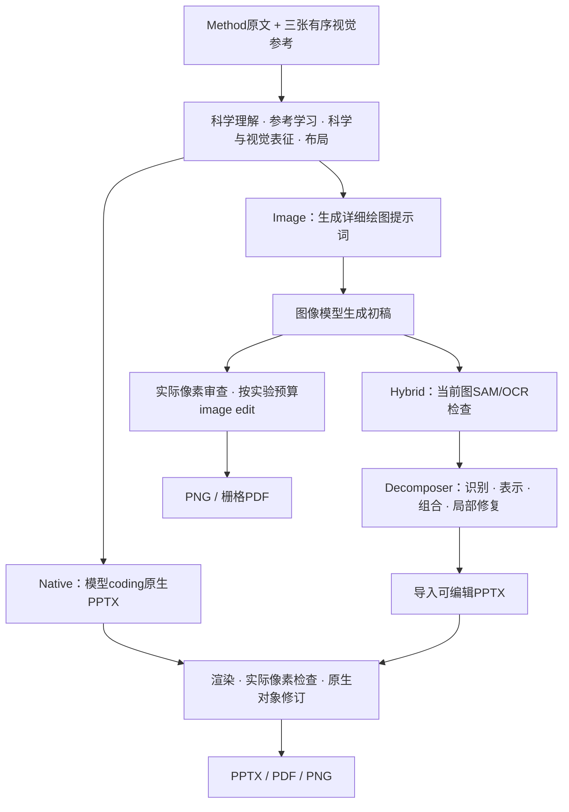
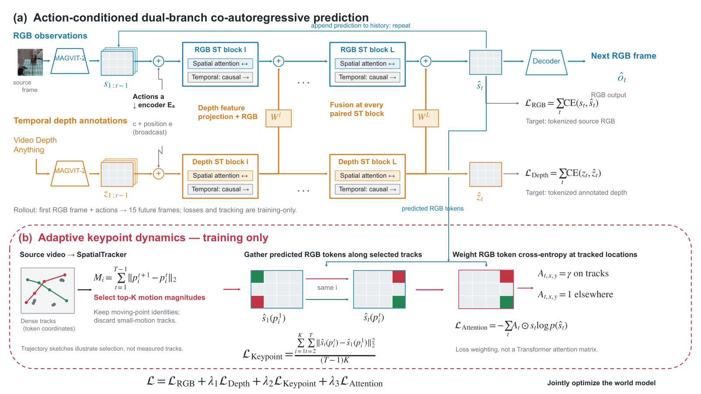
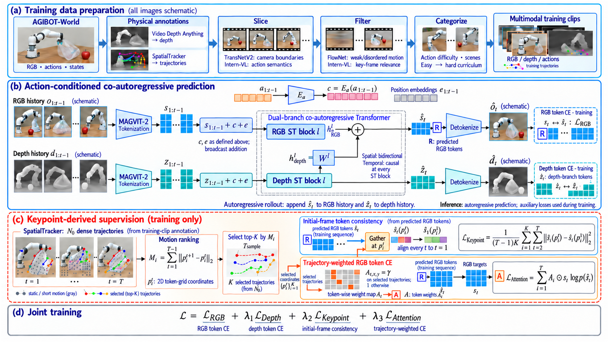
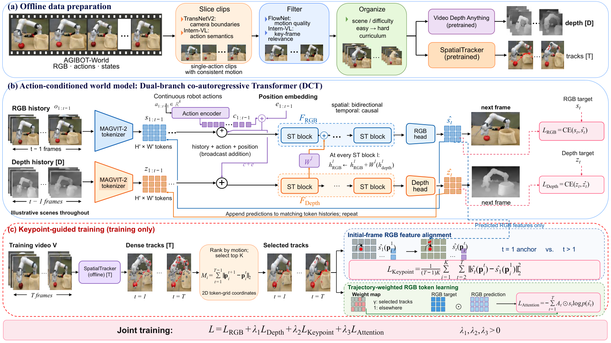
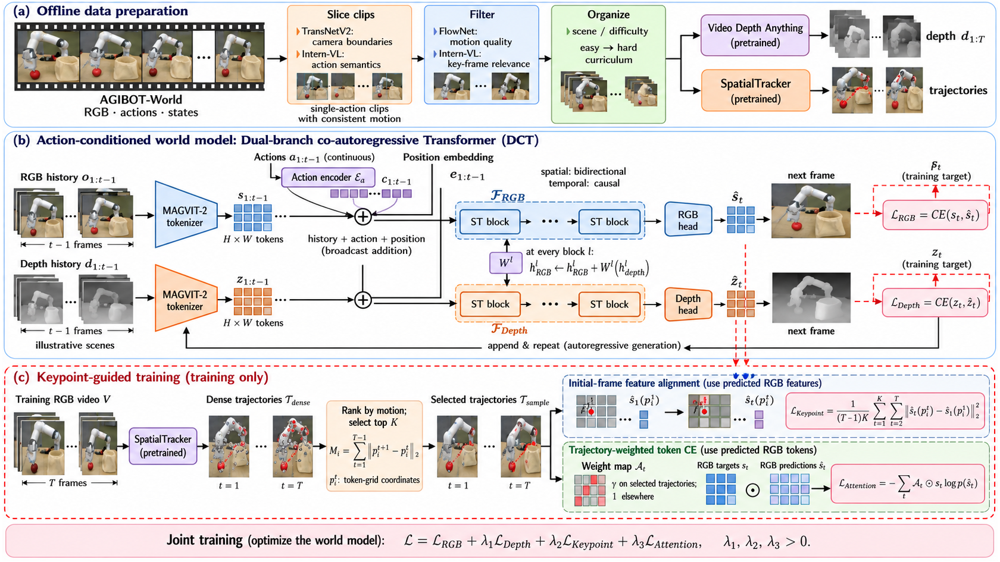
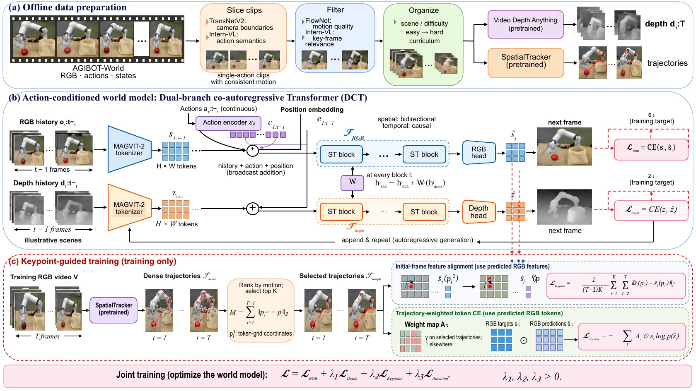

# FigureCrafter

**从论文 Method 文本和参考图片，生成科研方法图。** 三种方法共享 FigureCrafter v2.5.1 的科学理解、参考学习、表征与布局设计、像素审查和修订原则，分别通过原生代码、图像模型，以及图像重建与原生完善输出结果。

FigureCrafter provides three scientific figure generation workflows: **Native**, **Image**, and **Hybrid**. The model makes the scientific and visual decisions; the harness executes tools and preserves evidence.

当前三条主路径可通过兼容模型 HTTP API 独立运行，**不需要安装 Codex、Codex skills 或私有 `@oai/artifact-tool`**。仍需自备模型服务与凭据，以及各方法所需的公开工具。历史内置 Image 分支另需其实际图像工具环境，不属于独立运行路径。具体依赖与验证边界见 [独立运行审查](docs/STANDALONE.zh-CN.md)。

| 入口 | 内容 |
| --- | --- |
| [三方法介绍](docs/THREE_METHODS.zh-CN.md) | 各自流程、共同点、区别、实验能回答什么 |
| [安装与运行](docs/QUICKSTART.zh-CN.md) | Method 输入、模型工具闭环、图像生成、Decomposer 与原生接续 |
| [通用模型启动说明](docs/MODEL_START_PROMPT.md) | 在单样例工作目录执行完整流程；手动工具桥接时使用 |
| [案例与状态](showcases/figurecrafter/README.md) | RoboScape 三条流程、Hybrid 三阶段、52 张 Nano 零 edit 初稿 |
| [代码与版本](docs/CODE_MAP.zh-CN.md) | 完整方法源码、固定 Decomposer、哈希与适配边界 |
| [历史 Native 300 例](showcases/formal300-v2.5.1/README.md) | 保留的历史展示，单独标明条件 |

## 三条流程



| 方法 | 绘制与修改方式 | 输出及可编辑性 | 主要研究问题 |
| --- | --- | --- | --- |
| **FigureCrafter-Native** | 模型编写代码生成 PPTX，持续修改原生对象 | 原生文字、形状、线条等可编辑；局部照片仍是图像 | 直接原生生成能达到什么科学与视觉质量？ |
| **FigureCrafter-Image** | 模型完成理解与视觉方案，图像模型绘制；需要修改时用 image edit | 位图，不具有 PPTX 对象级可编辑性 | 图像模型作为最终绘制出口能带来什么表现力？ |
| **FigureCrafter-Hybrid** | 图像方案 → Decomposer 重建 → FigureCrafter 原生完善 | 可编辑 PPTX，保留原子栅格资产并披露边界 | 原生重建能保留多少图像表现力，后续完善能修复什么？ |

Native 基线严格为原版 **v2.5.1**。这里没有另造简化 Native。Method 文本适配和后端扩展独立保存，原版及四份指南保持原样。

## 实际案例

RoboScape 的下列图片说明输出形式，**不构成三方法受控排名**：Native 来自历史 PDF 输入；Image 和 Hybrid 来自数据集 Method，且各有独立的图像方案。历史内置 image 案例与当前 Nano Banana Pro 批量初稿也不混作同一实验。

| Native | Image | Hybrid |
| --- | --- | --- |
|  |  |  |
| 原生可编辑，[PPTX](showcases/figurecrafter/roboscape/native.pptx) | 已用 3 次 edit，仍需修改 | 作者模型复审通过，[PPTX](showcases/figurecrafter/roboscape/hybrid.pptx) |

Hybrid 的实际接续过程：

| 图像方案 | Decomposer 重建 | FigureCrafter 完善 |
| --- | --- | --- |
|  |  |  |

**当前 Image 零 edit 实验：52/60 张初稿已生成；8 篇因提示词超过 25,000 字符暂缓。** 原 44 张自审为 `needs_edit`，补跑 8 张尚未科学/视觉审查。生成完成与质量通过分别统计。[查看全部 52 张](showcases/figurecrafter/image52/index.html)。

下载仓库后双击 [离线画廊](showcases/figurecrafter/index.html) 可浏览图片和下载 PPTX。GitHub 网页不执行仓库里的 HTML。本仓库目前公开，未启用 GitHub Pages。

## 开始使用

Python 3.13 为已使用的环境。另安装 LibreOffice与支持视觉和工具调用的兼容模型 API；Hybrid 还需要 Node、Poppler、结构化视觉模型 API，以及实际 SAM3 / PP-OCRv5 服务。

```sh
python3 -m venv .venv
.venv/bin/python -m pip install -r requirements.txt
.venv/bin/python figurecrafter.py doctor
.venv/bin/python figurecrafter.py prepare --method native \
  --inputs examples/roboscape-method --workspace /absolute/path/to/native-case \
  --model gpt-6.1-sol
```

这一步准备隔离工作目录，**不会代替模型完成科研绘图**。将 `configs/model.example.json` 复制为 `configs/model.local.json`，填入已有模型 API 地址；密钥通过该配置的 `api_key_env` 对应环境变量提供。随后直接运行完整模型工具循环：

```sh
.venv/bin/python figurecrafter.py run --method native \
  --workspace /absolute/path/to/native-case --config configs/model.local.json
```

配置模型必须与 `prepare --model` 一致，模型服务须实际支持图像输入与工具调用。也可按 [通用启动说明](docs/MODEL_START_PROMPT.md) 手动桥接同一工具接口。

当前 Nano 零 edit 后端用 `--method image`；历史内置 image 的最多 3 次 edit 后端用 `--method image-builtin`。配置与完整 Hybrid 操作见 [Quickstart](docs/QUICKSTART.zh-CN.md)。API 凭据由使用者在本地配置，不随仓库分发。

## 代码与实验边界

- `methods/drawing-v2.5.1/`：19 文件原版冻结基线。
- `methods/method-text/`：当前 Method 输入的 Native、Nano 零 edit Image、Hybrid 原生接续源码。
- `methods/builtin-image/`：Method 输入的内置 image / Hybrid 扩展，保留最多 3 次 edit 机制。
- `methods/decomposer/`：固定 `v1.2-rc1h1-method2.2`，包含 Recognition / Representation / Composition / Refinement、知识种子、字体及许可证、服务器识别 worker。
- `figurecrafter.py`：仅提供路径、工具派发与运行时连接，不设计科学布局、不替模型写作者代码、不降低质量门槛。

**通用 image edit 上限为每样例累计 3 次；零 edit 实验上限为 0。** 初稿不计 edit；失败及分支共享累计预算。Hybrid 的原生对象修订不等于 image edit。

本仓库保留 `framework/`、`versions/`、`production-guides/` 等历史目录。新增入口不会覆盖它们，也不会自动启动批量或 FigureEvolver。正式生产不向模型开放其他样例产物、展示页、目标原图或参考 PDF/PPTX。

历史 `runtime/portable.py` 属于 v2.5，仍要求私有 artifact-tool 与技能文档；当前独立入口是 `figurecrafter.py`，不要将历史环境检查当成当前安装要求。冻结源码中的旧绝对路径保留用于来源核验，主入口通过显式运行级配置覆盖；这不是一份删除所有历史 Codex 字样的仓库。
